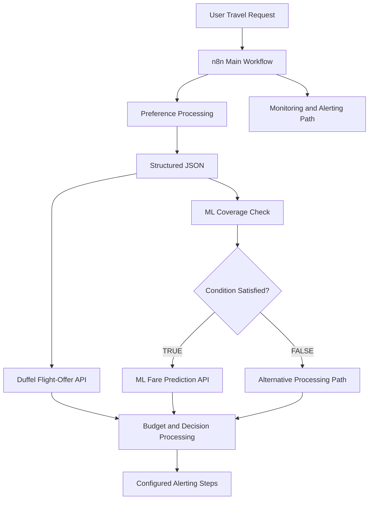

# ✈️ Agentic Flight Fare Intelligence & Budget Alert System

An Agentic AI-powered flight fare intelligence system that combines workflow automation, machine learning, and flight-offer API integration to support budget-aware travel decisions.

The project uses n8n to coordinate AI-based preference processing, flight-offer retrieval through Duffel, historical fare prediction through a Python ML pipeline, conditional decision-making, and alerting workflows.

## 📌 1. Project Overview

Finding suitable flights involves processing travel preferences, comparing available offers, evaluating prices against a budget, and deciding which options are worth considering. Performing these tasks manually can be repetitive and time-consuming.

The **Agentic Flight Fare Intelligence & Budget Alert System** brings these operations together in an automated workflow. Users provide their travel requirements in natural language, and the system processes them into structured information for downstream flight-search and fare-analysis tasks.

The project integrates four logical Agentic AI responsibilities with n8n workflow orchestration, the Duffel API, and a machine-learning model trained on historical fare data. The main workflow also includes monitoring and alerting steps to demonstrate the monitoring and notification process.

## 🎯 2. Objectives

- Automate the processing of natural-language flight requests.
- Extract travel preferences into structured JSON.
- Retrieve flight offers through the Duffel API.
- Integrate machine learning for historical fare prediction.
- Evaluate retrieved fares against user-defined budget requirements.
- Use conditional workflow branches for different processing paths.
- Organise decision-making and alerting through automation.
- Demonstrate the integration of Agentic AI, APIs, Python, and machine learning.

## ✨ 3. Key Features

- **Natural-Language Input:** Accepts conversational travel requirements.
- **AI-Based Preference Extraction:** Converts user requests into structured travel information.
- **Flight-Offer Integration:** Retrieves flight offers through Duffel API integration.
- **ML-Based Fare Intelligence:** Predicts historical fares for supported inputs.
- **Conditional Workflow Processing:** Supports TRUE and FALSE execution paths.
- **Budget-Based Evaluation:** Processes fare information against the user's stated budget.
- **Alerting Workflow:** Includes configured alerting steps within the automation.
- **Monitoring and Alerting Path:** Includes monitoring-related processing within the main workflow.
- **Modular Design:** Separates workflow orchestration, flight retrieval, and ML functionality.

## 🏗️ 4. System Architecture



The diagram illustrates the system's main components and their logical relationships. The exact execution order and branch behaviour are determined by the exported n8n workflow.

## 🤖 5. Agentic AI Components

The project is organised around four logical AI responsibilities.

### 5.1 Preference Agent

Processes the user's natural-language travel request and extracts relevant preferences, including origin, destination, departure date, passenger count, budget, airline, cabin class, and flexibility where provided.

### 5.2 Fare Intelligence Agent

Supports fare-related analysis by using flight information and the ML prediction component when the required historical data coverage is available.

### 5.3 Decision Agent

Supports the evaluation of retrieved fare information against the user's travel requirements and configured budget-related decision logic.

### 5.4 Alerting Agent

Supports the notification stage of the workflow, working with the configured decision and alerting steps.

These names represent the logical responsibilities of the system. They do not imply that all four components operate as separate deployed services; their implementation depends on the configured AI nodes, prompts, and workflow connections.

## 🔄 6. Main End-to-End Workflow

The main n8n workflow coordinates the project's AI processing, flight-search integration, ML requests, conditional branches, and downstream decision steps.

1. **Receive Travel Request** – Accepts the user's natural-language flight requirements.
2. **Extract Preferences** – Processes the request into structured JSON.
3. **Retrieve Flight Offers** – Sends the supported travel parameters to the Duffel API integration.
4. **Check ML Coverage** – Checks whether the requested route and airline are represented in the historical dataset.
5. **Follow Conditional Branch** – Routes execution through the TRUE or FALSE path based on the configured IF-node condition.
6. **Predict Historical Fare** – The ML-supported path can call the Flask API to generate a fare estimate.
7. **Evaluate Fare Information** – Processes retrieved offers and budget-related information through the configured decision logic.
8. **Continue Alerting Steps** – Passes the relevant information through the configured alerting stage.

The TRUE and FALSE labels refer to the workflow's conditional logic. They should not automatically be interpreted as “within budget” and “over budget”; the precise meaning depends on the IF-node expression.

## 🧠 7. Machine-Learning Component

The project includes a Random Forest regression pipeline trained on historical fare data. It provides an estimated fare for supported feature combinations and is integrated with the workflow through a Flask API.

**Model inputs:** Route, Airline, Year, and Direction.

**Target variable:** Price.

The preprocessing pipeline one-hot encodes the categorical features and passes the Year feature through before applying the regression model.

### Model Configuration

| Parameter                |                   Value |
| ------------------------ | ----------------------: |
| Algorithm                | Random Forest Regressor |
| Number of estimators     |                     200 |
| Maximum depth            |                      10 |
| Minimum samples per leaf |                       2 |
| Train/test split         |               80% / 20% |
| Random state             |                      42 |

### Verified Evaluation Results

The training script was executed successfully using the project's 114-row historical dataset. Evaluation was performed on a held-out test split containing 23 samples.

| Metric                         |  Result |
| ------------------------------ | ------: |
| Mean Absolute Error (MAE)      | ₹344.12 |
| Root Mean Squared Error (RMSE) | ₹405.73 |
| R² Score                       |  0.9395 |

These metrics describe performance on the reported test split. Since the dataset is small and historical, they do not guarantee equivalent accuracy for unseen routes, future fares, or live flight offers.

The fitted preprocessing and prediction pipeline is saved as `ml/fare_prediction_model.joblib`.

## 🌐 8. Flight-Offer API Integration

The project integrates with the **Duffel API** to retrieve flight offers based on the processed travel preferences.

The configured workflow uses HTTP requests and the required authentication settings to communicate with the service. Returned offers provide flight-search information for subsequent workflow processing.

The API integration and the ML component serve different purposes:

- **Duffel:** Retrieves flight offers from the configured API environment.
- **ML model:** Estimates historical fares from the training data.

Test-mode offers may be synthetic and should not be assumed to represent live, bookable inventory or guaranteed ticket prices.

## 💰 9. Budget Evaluation and Decision-Making

Budget-related processing considers the user's stated budget alongside retrieved flight information.

The workflow's configured decision logic determines how the relevant fare information is evaluated and passed to subsequent stages. The historical ML prediction provides an additional estimate; it is not a replacement for the price of a retrieved flight offer.

The system is intended to support travel decisions. Final availability, fare conditions, and booking prices should always be verified with the relevant provider.

## 🔔 10. Monitoring and Alerting Workflow

The main n8n workflow includes monitoring and alerting steps to demonstrate the monitoring and notification process.

The monitoring path has been manually tested. Scheduled execution is currently deactivated, so the project should not be described as continuously monitoring fares or sending alerts in the background.

The main workflow also includes configured alerting steps. The TRUE branch, FALSE branch, and monitoring-related notification paths have been tested. These results demonstrate the tested execution paths, but they do not establish that continuous monitoring is active.

## 🛠️ 11. Technology Stack

| Technology                            | Purpose                                                   |
| ------------------------------------- | --------------------------------------------------------- |
| n8n                                   | Workflow orchestration and automation                     |
| Google Gemini / Google AI integration | AI-based preference processing and configured agent tasks |
| Python                                | ML training and prediction API                            |
| Flask                                 | Exposes ML functionality through HTTP endpoints           |
| pandas                                | Historical fare-data processing                           |
| scikit-learn                          | Preprocessing, model training, and evaluation             |
| Random Forest Regression              | Historical fare prediction                                |
| joblib                                | Saving and loading the trained ML pipeline                |
| Duffel API                            | Flight-offer retrieval                                    |
| Cloudflare Quick Tunnel               | Temporary external access to the locally hosted ML API    |
| JSON                                  | Structured data and workflow exports                      |
| Git and GitHub                        | Version control and project hosting                       |

## 📂 12. Repository Structure

```text
Agentic Flight Fare Intelligence & Budget Alert System/
│
├── api/
│   └── app.py
│
├── data/
│   ├── full_fare.csv
│   └── duffel_offers_clean.csv
│
├── ml/
│   ├── train_fare_model.py
│   ├── test_fare_prediction.py
│   └── fare_prediction_model.joblib
│
├── Agentic Flight Fare Intelligence & Budget Alert System.json
├── Duffel___Flight_Offers_Search.json
├── prepare_fare_data.py
├── requirements.txt
├── .gitignore
└── README.md
```

### Main Components

- **`Agentic Flight Fare Intelligence & Budget Alert System.json`:** Export of the primary n8n workflow.
- **`Duffel___Flight_Offers_Search.json`:** Export of the separate Duffel flight-offer search workflow.
- **`api/app.py`:** Flask application exposing the ML functionality.
- **`data/full_fare.csv`:** Historical dataset used for model training.
- **`data/duffel_offers_clean.csv`:** Cleaned flight-offer dataset.
- **`ml/train_fare_model.py`:** Preprocessing, model training, evaluation, and model saving.
- **`ml/test_fare_prediction.py`:** Loads the saved pipeline and runs a sample prediction.
- **`ml/fare_prediction_model.joblib`:** Saved ML pipeline.
- **`prepare_fare_data.py`:** Supporting fare-data preparation script.
- **`requirements.txt`:** Python dependency list.
- **`.gitignore`:** Excludes virtual environments and files that should not be tracked.

The main workflow export is saved as `Agentic Flight Fare Intelligence & Budget Alert System.json`. The separate Duffel flight-offer workflow export is saved as `Duffel___Flight_Offers_Search.json`. Both files have been validated as JSON. The main workflow contains 46 nodes and 43 connection groups.

Public-export email addresses and temporary tunnel URLs have been replaced with placeholders. Configure valid credentials, email addresses, and a reachable ML endpoint before running an imported copy.

## ⚙️ 13. Setup and Execution

### Prerequisites

- Python
- n8n instance
- Duffel API access and required credentials
- Google AI/Gemini credentials for the configured AI nodes
- Cloudflare Quick Tunnel when cloud-hosted n8n needs access to a locally hosted Flask API

### Step 1: Clone the Repository

```bash
git clone https://github.com/YOUR_USERNAME/YOUR_REPOSITORY.git
cd YOUR_REPOSITORY
```

Replace the example URL with the actual GitHub repository URL.

### Step 2: Create and Activate a Virtual Environment

On Windows PowerShell:

```powershell
python -m venv .venv
.\.venv\Scripts\Activate.ps1
```

### Step 3: Install Dependencies

```powershell
pip install -r requirements.txt
```

### Step 4: Train the ML Model (Optional)

The saved model is included in the repository. To retrain it using the available historical dataset:

```powershell
python .\ml\train_fare_model.py
```

The script prints the evaluation metrics and sample predictions, then saves the fitted pipeline.

### Step 5: Start the Flask API

```powershell
python .\api\app.py
```

Keep the Flask process running. Use the host, port, and endpoint paths defined in `api/app.py`.

### Step 6: Configure Tunnel Access

If n8n is hosted in the cloud and Flask runs locally, start a Cloudflare Quick Tunnel and update the relevant ML HTTP Request nodes with the active tunnel URL.

The local main workflow export uses this placeholder:

```text
https://YOUR-CLOUDFLARE-TUNNEL.trycloudflare.com
```

Replace it before executing the workflow. Quick Tunnel URLs can change when the tunnel restarts.

### Step 7: Import and Configure n8n Workflows

1. Import `Agentic Flight Fare Intelligence & Budget Alert System.json` into n8n.
2. Import `Duffel___Flight_Offers_Search.json` if required by your setup.
3. Select or reconnect the required credentials.
4. Verify HTTP Request URLs, endpoint paths, expressions, and IF-node conditions.
5. Replace the example email-address placeholders with valid addresses in the relevant email nodes.
6. Test the main workflow paths with sample travel requests.
7. Test the monitoring and alerting path manually if you want to reproduce its demonstration.

Credentials must be configured separately in n8n and must not be committed to the repository.

## 🧪 14. Testing and Demonstration

The following demonstrations have been completed:

- Main workflow — TRUE branch / ML-supported path.
- Main workflow — FALSE branch / alternative processing path.
- Monitoring-related notification path — manual execution.
- ML model training and evaluation.
- Sample prediction using the saved pipeline.

The model-training run produced the verified MAE, RMSE, and R² results reported in this README.

The three screen recordings provide evidence of the demonstrated workflow behaviour. They should be included in the repository only if they are intended to be publicly accessible.

## 🔐 15. Security, Challenges and Limitations

### Security

- Keep API keys, tokens, passwords, and private credentials out of tracked files.
- Configure n8n credentials separately after importing workflows.
- Review workflow exports before publishing them.
- Public workflow exports use placeholders for email addresses and temporary tunnel URLs; replace them with valid configuration values when importing.
- Treat a Cloudflare Quick Tunnel as temporary access rather than a permanent production endpoint.

### Challenges Faced

- Processing natural-language requests into structured JSON.
- Coordinating AI tasks and conditional branches in n8n.
- Integrating the flight-offer API with the ML pipeline.
- Connecting cloud-hosted workflows to a locally running Flask API.
- Handling temporary tunnel URLs.
- Evaluating a model trained on a limited historical dataset.
- Distinguishing historical fare estimates from retrieved flight prices.

### Limitations

- The historical dataset contains only 114 records and has limited route and airline coverage.
- Model metrics are based on a held-out split and may not generalise to future prices.
- Historical predictions are not guaranteed live fares.
- API test data may not represent bookable flight inventory.
- The monitoring schedule is currently deactivated.
- Notification delivery and continuous monitoring should not be claimed unless supported by execution evidence.
- The exported workflow JSON files have been saved and validated, but credentials, email addresses, and environment-specific URLs must be configured and the imported workflows must be tested in the target n8n instance.

## 💡 16. Advantages and Future Enhancements

### Advantages

- Reduces repetitive processing of travel requirements.
- Combines natural-language AI with workflow automation.
- Integrates flight-offer retrieval and historical fare prediction.
- Uses conditional processing for different workflow paths.
- Separates API, ML, and orchestration responsibilities.
- Provides a foundation for further intelligent travel automation.

### Future Enhancements

- Expand the historical dataset across more routes, airlines, and travel dates.
- Evaluate the model using larger datasets and time-aware validation.
- Incorporate more useful temporal features for fare analysis.
- Enable and verify scheduled fare monitoring.
- Add and test additional notification channels, such as Telegram.
- Improve API error handling, logging, and retry behaviour.
- Deploy the Flask API to a stable hosting environment.
- Refine budget decisions and monitoring logic using verified offer data.

## 🎓 17. Project Details and Learning Outcomes

**Project Details**

- **Project Title:** Agentic Flight Fare Intelligence & Budget Alert System
- **Author:** Avantikaa Balamurali
- **Project Domain:** Travel Technology, Agentic AI, Machine Learning and Intelligent Automation
- **Workflow Platform:** n8n
- **ML Language:** Python
- **Flight-Offer Integration:** Duffel API

**Learning Outcomes**

The project provides practical experience in Agentic AI concepts, prompt-based information extraction, n8n workflow orchestration, REST API integration, Python-based ML pipelines, regression evaluation, Flask API development, and testing multi-component automation systems.

## 🌟 18. Conclusion

The Agentic Flight Fare Intelligence & Budget Alert System demonstrates how Agentic AI, workflow automation, flight-offer integration, and machine learning can be combined to support budget-aware travel decisions.

By connecting natural-language preference processing with API retrieval, historical fare prediction, conditional processing, and alerting workflows, the project provides a modular foundation for further development. Its limitations also highlight the importance of representative data, reliable API access, secure configuration, and evidence-based testing when developing intelligent automation solutions.
